<h1 align="center">CoFiDrive: Scene-Conditioned Registers and Coarse-to-Fine Trajectory Scoring for End-to-End Driving</h1>

  
  
  

## Overview

CoFiDrive is a camera-based driving planner that combines scene-conditioned register features, dual-memory trajectory scoring and training-only control-space augmentation.

- **TC (Semantic Token Compressor)** refines 64 camera registers through scene-conditioned mixing of six experts. The refined tokens support both trajectory generation and scoring.
- **CCS (Cross-Compression Scorer)** combines scene tokens with spatial patch features through candidate-dependent gated attention to score motion alternatives.
- **CSA (Control-Space Augmentation)** perturbs the acceleration and yaw rate of selected proposals to expand scorer supervision. It is used only during training.

At inference, the planner generates and scores 64 proposals. CSA adds no inference candidates or model parameters.

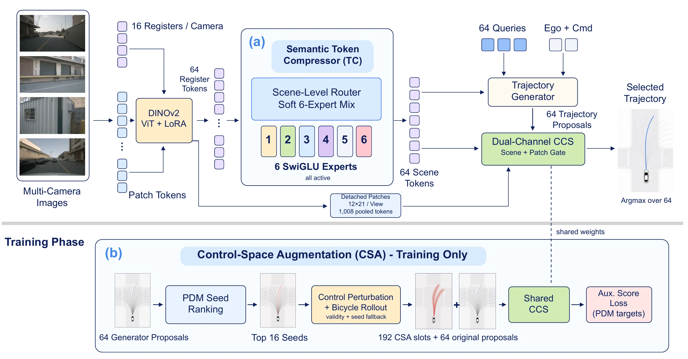

## Results

### NAVSIM-v1 navtest

Results follow the manuscript's main comparison. CoFiDrive uses 10 training epochs; other methods retain their reported protocols. All metrics are on a 0–100 scale.

| Method | NC | DAC | TTC | Comfort | EP | PDMS ↑ |
| --- | ---: | ---: | ---: | ---: | ---: | ---: |
| Ego-stat. MLP | 93.0 | 77.3 | 83.6 | 100.0 | 62.8 | 65.6 |
| UniVLA (base) | 96.9 | 91.1 | 91.7 | 96.7 | 76.8 | 81.7 |
| UniAD | 97.8 | 91.9 | 92.9 | 100.0 | 78.8 | 83.4 |
| LTF | 97.4 | 92.8 | 92.4 | 100.0 | 79.0 | 83.8 |
| PARA-Drive | 97.9 | 92.4 | 93.0 | 99.8 | 79.3 | 84.0 |
| DriveX-S | 97.5 | 94.0 | 93.0 | 100.0 | 79.7 | 84.5 |
| World4Drive | 97.4 | 94.3 | 92.8 | 100.0 | 79.9 | 85.1 |
| DRAMA | 98.0 | 93.1 | 94.8 | 100.0 | 80.1 | 85.5 |
| PRIX | 98.1 | 96.3 | 94.1 | 100.0 | 82.3 | 87.8 |
| DiffusionDrive | 98.2 | 96.2 | 94.7 | 100.0 | 82.2 | 88.1 |
| DIVER | 98.5 | 96.5 | 94.9 | 100.0 | 82.6 | 88.3 |
| AutoVLA (Post-RFT) | 98.4 | 95.6 | 98.0 | 99.9 | 81.9 | 89.1 |
| VADv2 | 98.3 | 97.4 | 95.7 | 100.0 | 82.3 | 89.3 |
| DriveVLA-W0 (query) | 98.7 | 99.1 | 95.3 | 99.3 | 83.3 | 90.2 |
| ReCogDrive | 97.9 | 97.3 | 94.9 | 100.0 | 87.3 | 90.8 |
| Hydra-MDP++ (V2-99) | 98.6 | 98.6 | 95.1 | 100.0 | 85.7 | 91.0 |
| iPad | 98.6 | 98.3 | 94.9 | 100.0 | 88.0 | 91.7 |
| **CoFiDrive (train85k)** | **99.0** | **98.2** | **96.2** | **100.0** | **88.3** | **92.4** |
| **CoFiDrive (trainval103k)** | **99.0** | **98.4** | **96.0** | **100.0** | **89.6** | **92.9** |

The train85k main result is the mean of three independent training seeds. This aggregation does not extend to trainval103k or NavHard.

### NAVSIM-v2 NavHard

| Method | EPDMS ↑ |
| --- | ---: |
| RAP-DINO | 39.6 |
| GTRS-DrivoR | 45.8 |
| DrivoR (local reproduction) | 47.3 |
| **CoFiDrive** | **48.0** |

CoFiDrive and the local DrivoR baseline use the same 10-epoch training and evaluation protocol. The local 47.3 result is distinct from DrivoR's published 48.3 EPDMS.

## Visualizations

### Trajectory planning

Four scenes from the paper. Each column compares DrivoR and CoFiDrive on the same scene; each planner generates and scores its own candidates. Blue curves show proposals, yellow marks the selected trajectory, and white is the reference where shown.

<table>
  <tr><th width="25%">Straight</th><th width="25%">Left turn</th><th width="25%">Right turn</th><th width="25%">Straight · Scene 2</th></tr>
  <tr><td> DrivoR</td><td>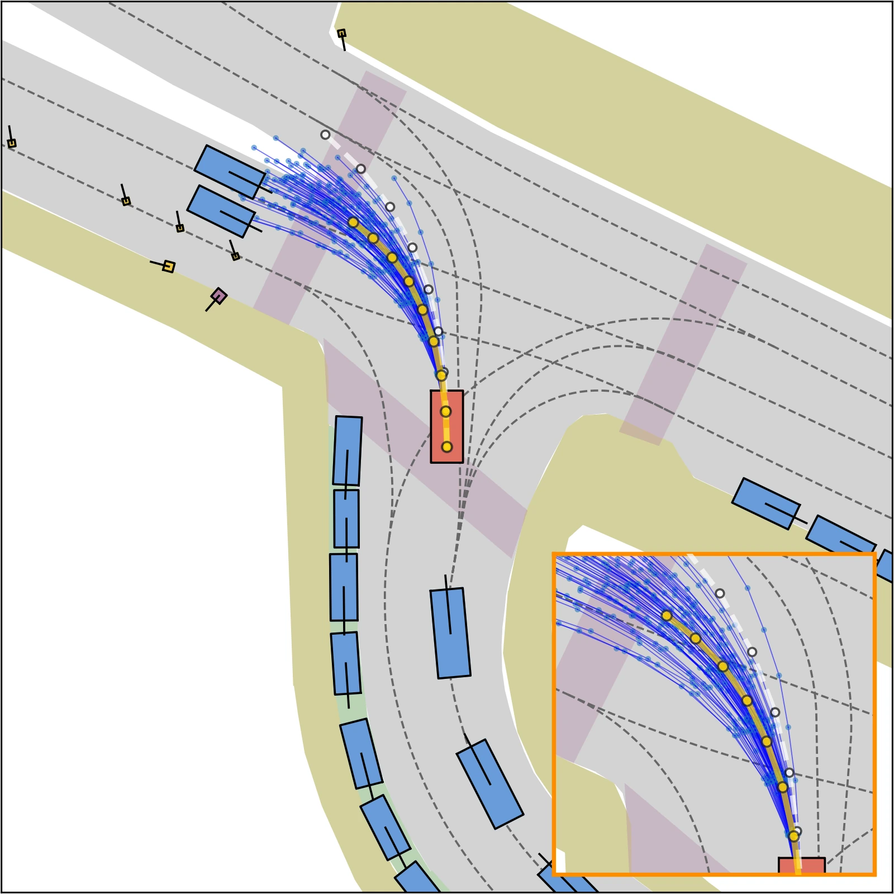 DrivoR</td><td>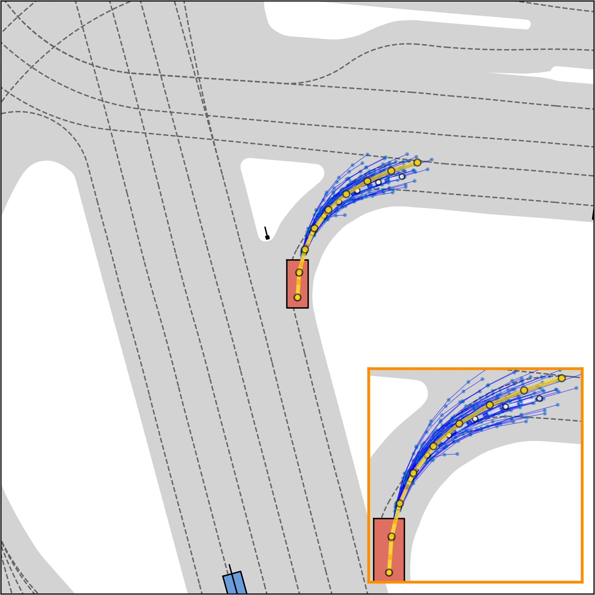 DrivoR</td><td>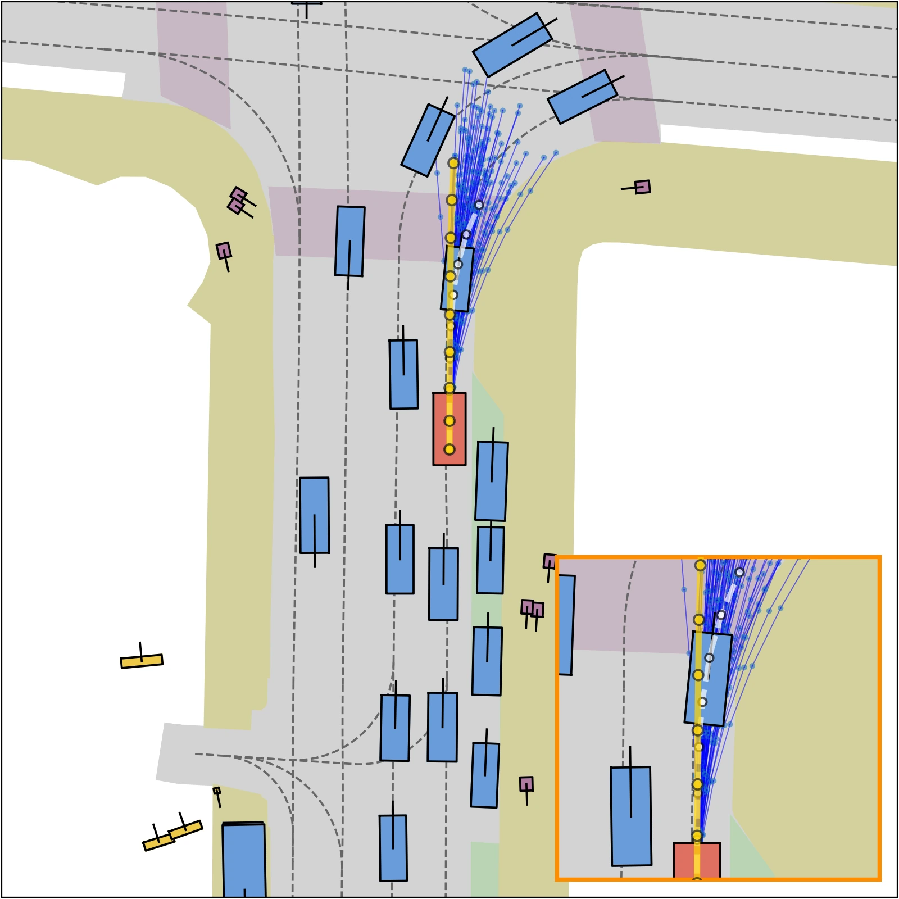 DrivoR</td></tr>
  <tr><td>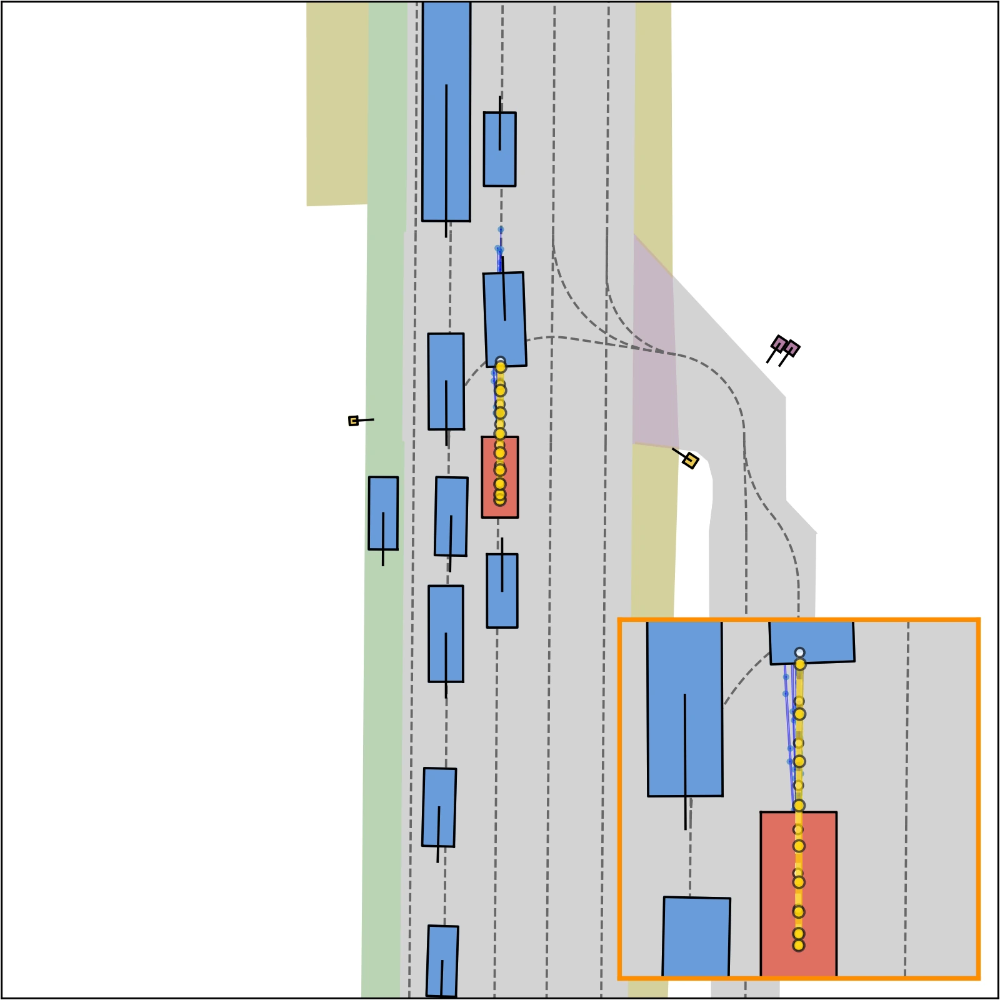 CoFiDrive</td><td>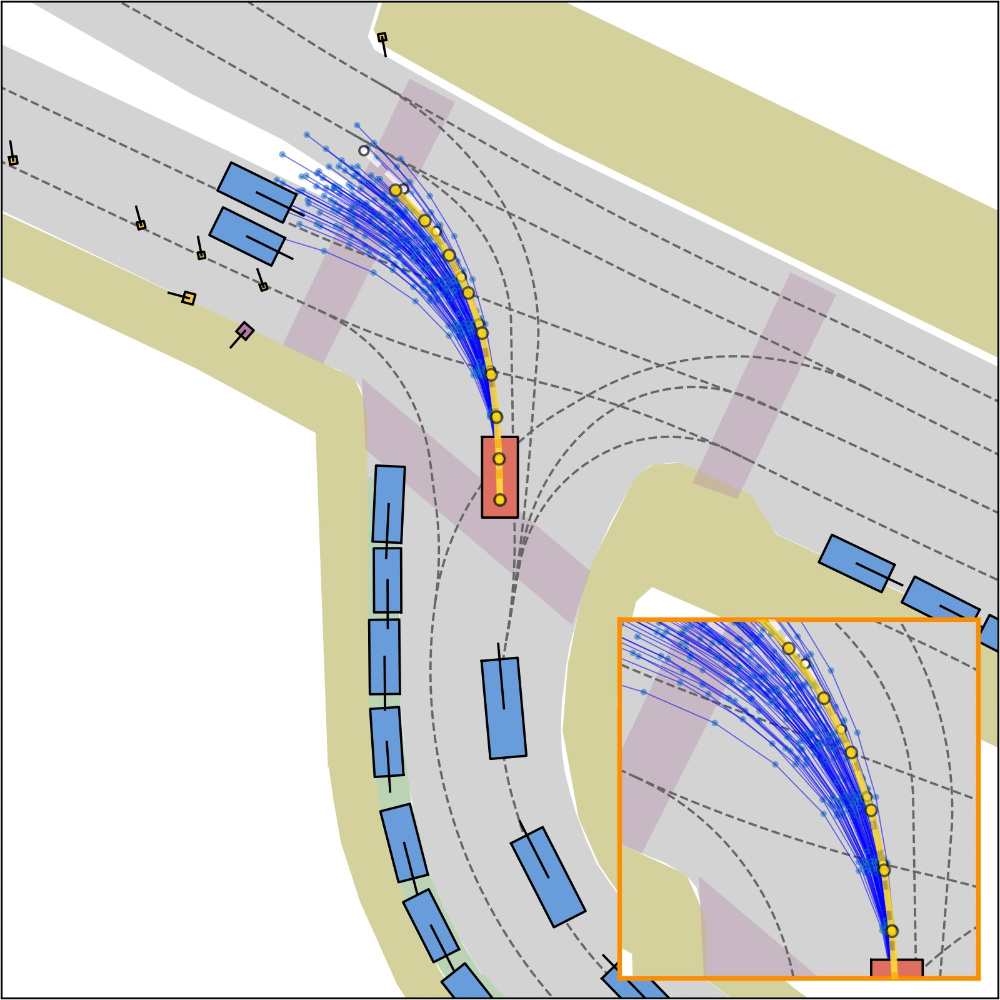 CoFiDrive</td><td>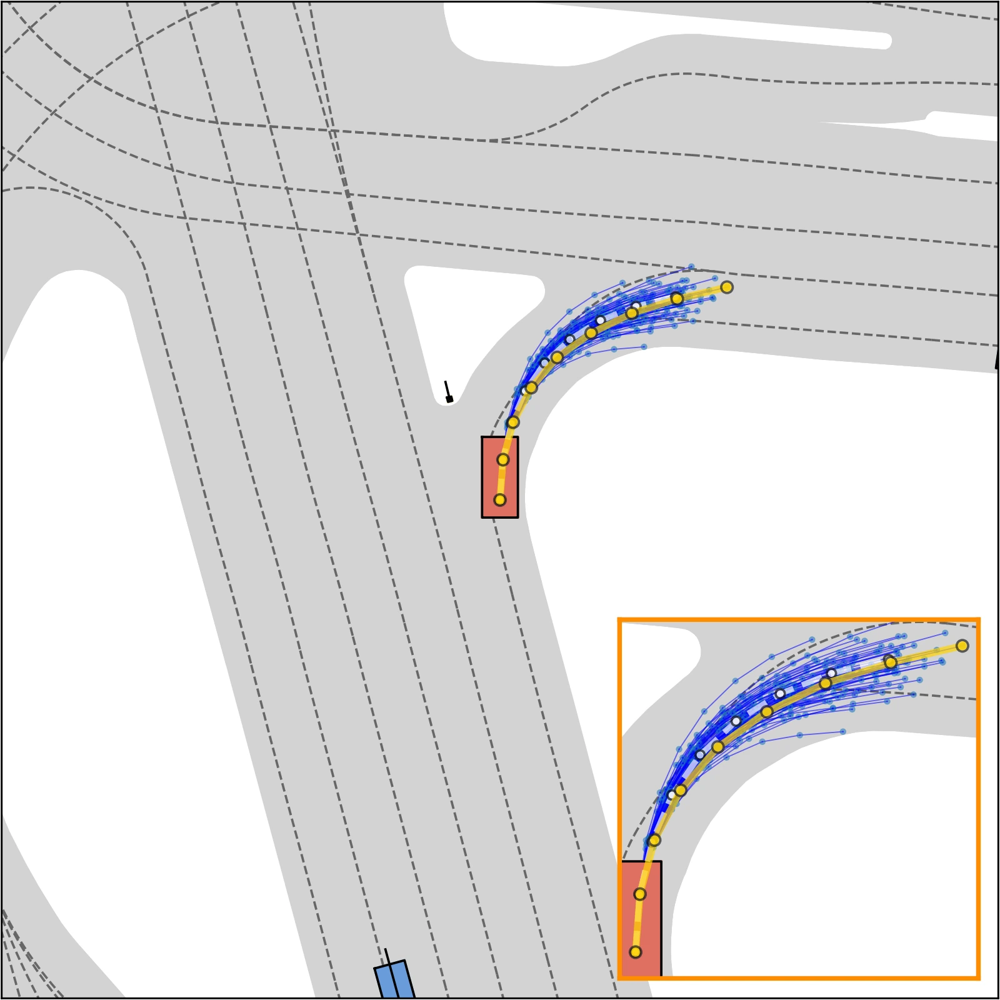 CoFiDrive</td><td>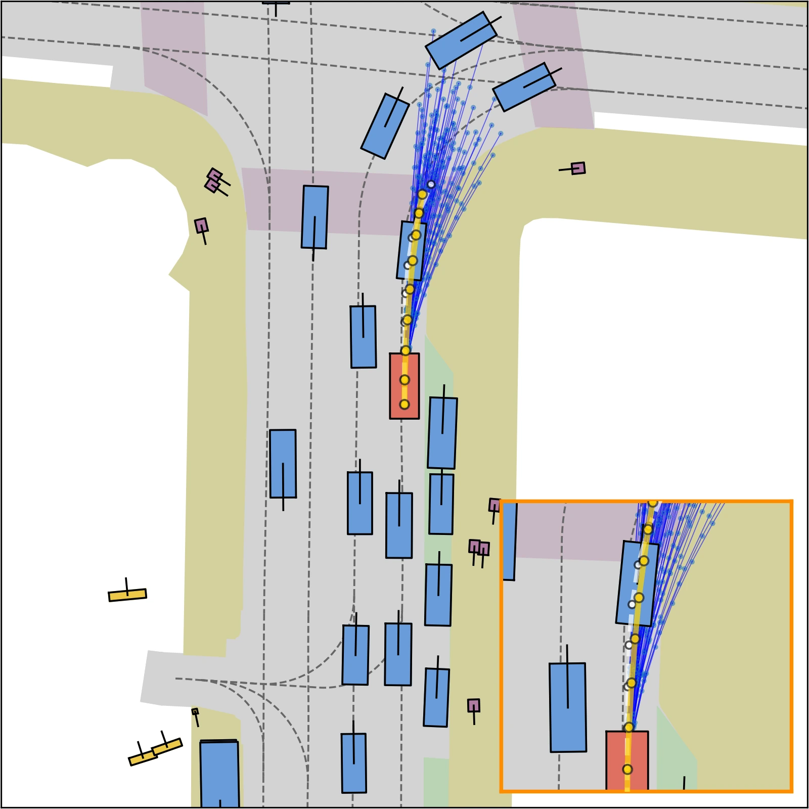 CoFiDrive</td></tr>
</table>

### Register attention

Mean attention in the four camera views. DrivoR is shown above CoFiDrive; warmer colors indicate higher displayed attention.

<table>
  <tr><th width="25%">Front</th><th width="25%">Left</th><th width="25%">Right</th><th width="25%">Rear</th></tr>
  <tr><td>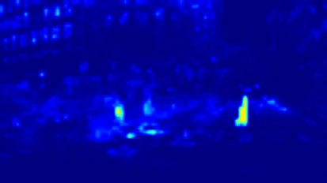 DrivoR</td><td>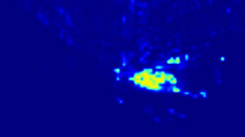 DrivoR</td><td>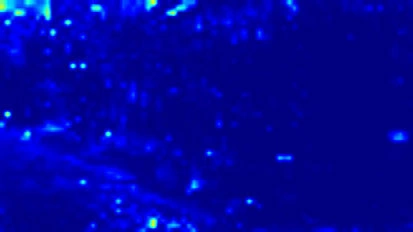 DrivoR</td><td>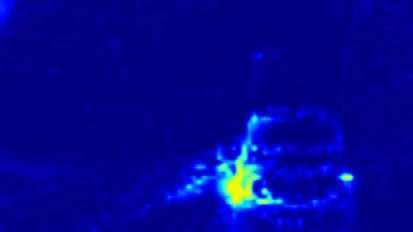 DrivoR</td></tr>
  <tr><td>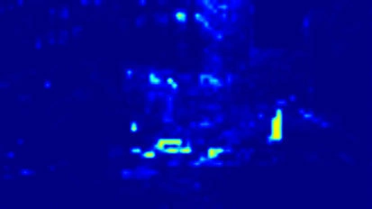 CoFiDrive</td><td>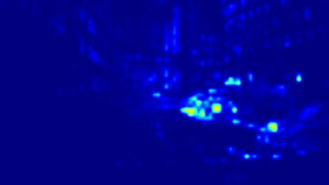 CoFiDrive</td><td>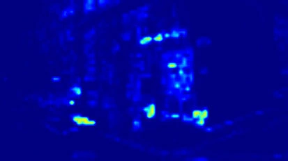 CoFiDrive</td><td>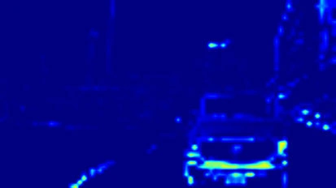 CoFiDrive</td></tr>
</table>

### Control-space augmentation

One saved scene before and after CSA: 64 original proposals and 192 additional training slots. The curves use stored trajectory coordinates. Failed augmentation slots retain their seeds.

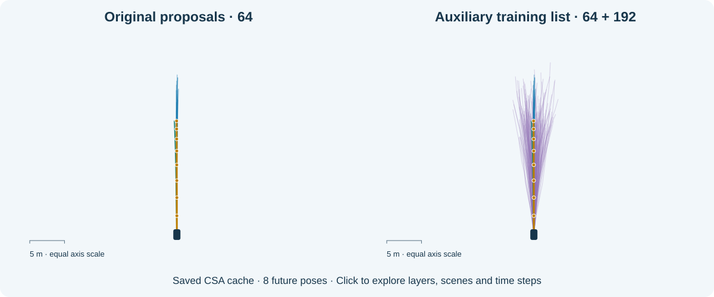

## Documentation

| Installation | Training | Evaluation | Method |
| :---: | :---: | :---: | :---: |
| [Environment and data](docs/setup.md) | [Train CoFiDrive](docs/reproduction.md#train85k-a-10-epoch-run) | [Evaluate checkpoints](docs/reproduction.md#evaluate-on-navtest) | [TC, CCS and CSA](docs/method.md) |

Detailed experiment tables and visualization instructions are in `docs/experiments.md` and `docs/visualizations.md`. Datasets, backbone weights and trained checkpoints are not bundled with the code. The configuration key remains `agent=more_ccs` for checkpoint compatibility.

## Acknowledgements

CoFiDrive builds on DrivoR, NAVSIM, nuPlan and DINOv2. We thank their authors for sharing their code and evaluation tools. The NAVSIM/DrivoR-derived code retains its Apache-2.0 license in `LICENSE`; the vendored nuPlan dependency retains its license in `nuplan-devkit/LICENSE.txt`.
