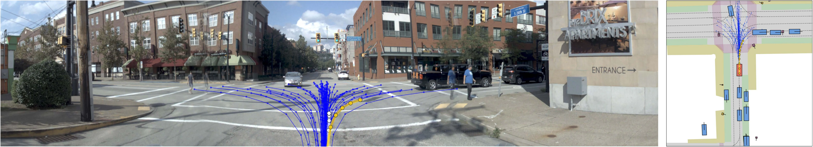
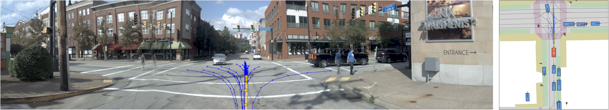
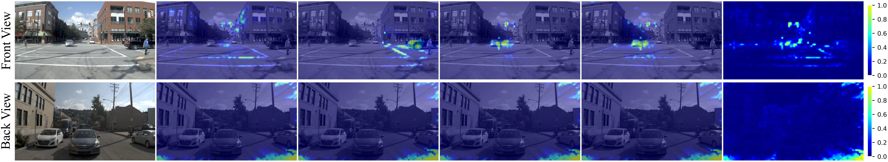

<h1 align="center">🚗 CoFiDrive: Scene-Conditioned Registers and<br>Coarse-to-Fine Trajectory Scoring for End-to-End Driving</h1>

<p align="center">
  
  <a href="https://github.com/Rtwotwo/DriveCoFi"></a>
  <a href="https://rtwotwo.github.io/DriveCoFi/"></a>
</p>

<p align="center">
  <a href="#-overview">Overview</a> ·
  <a href="#-results">Results</a> ·
  <a href="#-visualizations">Visualizations</a> ·
  <a href="#-getting-started">Getting started</a> ·
  <a href="#-training-and-evaluation">Training &amp; evaluation</a>
</p>

## 📰 News

- **2026.11.01** — Released the CoFiDrive implementation, training and evaluation launchers, and project-page source.

## 🔍 Overview

<p align="center">
  <a href="site/assets/source/Figure1.svg"></a>
</p>

**CoFiDrive combines scene-conditioned visual features, dual-memory trajectory scoring, and control-space augmentation for end-to-end driving.** Generating a maneuver requires road and traffic context; choosing among nearby trajectories also depends on local spatial details. CoFiDrive uses a compact scene memory for trajectory generation and gives the scorer access to both that memory and spatial image features. Training adds motion alternatives around promising proposals to improve the scorer's ability to compare candidates.

The method has three components:

- **TC · Semantic Token Compressor.** Four cameras contribute 16 learned registers each. A scene-level router mixes six SwiGLU experts to refine the resulting 64 scene tokens, which serve both the generator and scorer. The camera registers provide the compact representation; TC adapts their features to the scene while retaining all 64 tokens.
- **CCS · Cross-Compression Scorer.** Each proposal attends to the refined scene memory and 1,008 pooled image-patch tokens. A candidate-dependent gate combines the two responses to predict trajectory quality. Coarse-to-fine describes these two levels of visual detail.
- **CSA · Control-Space Augmentation.** During training, the top 16 proposals ranked by the PDM evaluator each seed 12 acceleration and yaw-rate perturbations. A bicycle model converts them into trajectories for auxiliary CCS supervision. The training list contains 192 augmentation slots and the original 64 proposals; unsuccessful slots retain their seed trajectories.

**At inference, CCS scores the original 64 generated proposals.** CSA expands training supervision without adding inference candidates or model parameters.

<p align="center">
  <a href="https://rtwotwo.github.io/DriveCoFi/#method">Method details</a> ·
  <a href="site/assets/source/Figure1.pdf">Architecture PDF</a> ·
  <a href="site/assets/source/Figure1.svg">Architecture SVG</a>
</p>

## 📊 Results

| Benchmark | Training split / setting | Training epochs | Metric | CoFiDrive |
| :--- | :--- | :---: | :---: | ---: |
| NAVSIM-v1 · navtest | train85k | 10 | PDMS ↑ | **92.4** |
| NAVSIM-v1 · navtest | trainval103k | 10 | PDMS ↑ | **92.9** |
| NAVSIM-v2 · NavHard | NavHard training protocol | 10 | EPDMS ↑ | **48.0** |

The train85k main result is averaged over three independently seeded training runs. NAVSIM-v1 and NavHard use their respective benchmark evaluation protocols. See the [project page](https://rtwotwo.github.io/DriveCoFi/#results) for results and the sequential component ablation.

## 🎬 Visualizations

### Trajectory planning

The following panels compare DrivoR and CoFiDrive on the same NAVSIM-v1 scene. Each planner generates and scores its own candidates. Blue lines show proposals; yellow shows the selected trajectory.

<table align="center">
  <tr>
    <td align="center" width="50%"><strong>DrivoR</strong></td>
    <td align="center" width="50%"><strong>CoFiDrive</strong></td>
  </tr>
  <tr>
    <td><a href="site/assets/source/Figure2_1.pdf"></a></td>
    <td><a href="site/assets/source/Figure2_2.pdf"></a></td>
  </tr>
</table>

### Register attention

Selected camera-register attention maps show how the compact scene representation attends to the observed scene. The figure compares DrivoR above with CoFiDrive below; columns show the image, individual registers, and mean attention.

<p align="center">
  <a href="site/assets/source/Figure3_1_new.pdf"></a>
</p>

<p align="center"><a href="https://rtwotwo.github.io/DriveCoFi/#evidence">View the full visualization gallery</a></p>

## 🛠️ Getting started

### Installation

Use Linux with Python 3.9 and a CUDA-compatible PyTorch installation. The original environment uses PyTorch 2.1; dependency versions are listed in [requirements.txt](requirements.txt) and [environment.yml](environment.yml).

```bash
git clone https://github.com/Rtwotwo/DriveCoFi.git
cd DriveCoFi

conda create -n cofidrive python=3.9 -y
conda activate cofidrive

# Install the PyTorch build appropriate for your CUDA environment first.
pip install -r requirements.txt
pip install -e ./nuplan-devkit
pip install -e .
```

### Data and pretrained weights

1. Prepare the NAVSIM data and nuPlan maps using the [NAVSIM instructions](https://github.com/autonomousvision/navsim) and the local [installation guide](docs/install.md).
2. Download the [DINOv2 ViT-S/14 register weights](https://huggingface.co/timm/vit_small_patch14_reg4_dinov2.lvd142m). Place `model.safetensors` at `weights/vit_small_patch14_reg4_dinov2.lvd142m/model.safetensors`, or update the path in [more_ccs.yaml](navsim/planning/script/config/common/agent/more_ccs.yaml).
3. Set the data, map, and experiment paths:

```bash
export OPENSCENE_DATA_ROOT=/path/to/navsim/dataset
export NUPLAN_MAPS_ROOT=/path/to/nuplan/maps
export NAVSIM_EXP_ROOT=/path/to/experiment/output
export CUDA_VISIBLE_DEVICES=0
```

Prepare the metric cache before evaluation. See [dataset splits](docs/splits.md) and the [metric-caching launcher](scripts/evaluation/run_metric_caching.sh) for the required configuration. Datasets, pretrained weights, and trained checkpoints are obtained separately.

## 🚀 Training and evaluation

### NAVSIM-v1 training

The release launcher trains on train85k for 10 epochs:

```bash
SEED=2 NUM_GPUS=1 bash scripts/release/train_navsim_v1.sh
```

Environment variables control the seed, batch size, number of GPUs, and output name. Additional Hydra options can be appended to the command:

```bash
CUDA_VISIBLE_DEVICES=0,1,2,3 SEED=3 NUM_GPUS=4 BATCH_SIZE=16 \
  EXPERIMENT_NAME=cofidrive/train85k_seed3 \
  bash scripts/release/train_navsim_v1.sh
```

### NAVSIM-v1 evaluation

Set `CHECKPOINT` to the trained model and run navtest evaluation:

```bash
CHECKPOINT=/path/to/checkpoint.ckpt NUM_GPUS=1 \
  bash scripts/release/eval_navsim_v1.sh
```

The evaluation launcher keeps 64 proposals and disables trajectory expansion. The Hydra agent key remains `agent=more_ccs` to preserve the existing configuration and checkpoint interfaces.

### NAVSIM-v2 evaluation

NavHard uses a separate two-stage EPDMS protocol. Its evaluation entry point is [run_pdm_score_gpu_v2.py](navsim/planning/script/run_pdm_score_gpu_v2.py); configure the NavHard data, caches, and checkpoint for that evaluator.

## 📁 Repository structure

```text
navsim/
  agents/more_ccs/       Full CoFiDrive model: TC + CCS + CSA
  agents/more_dual/      Dual-channel variant
  agents/more_tc/        TC variant
  planning/script/      Training, evaluation, and Hydra configurations
scripts/release/        Portable NAVSIM-v1 launchers
scripts/                Original experiment launchers
docs/                   Installation and dataset documentation
download/               Dataset download helpers
nuplan-devkit/          nuPlan dependency
viz/                    Planning visualization tools
site/                   Project website and paper figures
```

The original experiment launchers retain experiment-specific GPU and checkpoint settings. Use `scripts/release/` as the starting point for a new environment.

## 🙏 Acknowledgements

CoFiDrive builds on [DrivoR](https://github.com/valeoai/DrivoR) for register-based driving, [NAVSIM](https://github.com/autonomousvision/navsim) for training and evaluation, [nuPlan](https://github.com/motional/nuplan-devkit) for maps and planning utilities, and [DINOv2](https://github.com/facebookresearch/dinov2) for visual representations. We thank their authors for making these resources available.

For source-code licenses and attribution, see [LICENSE](LICENSE), [THIRD_PARTY.md](THIRD_PARTY.md), and the [nuPlan license](nuplan-devkit/LICENSE.txt).
